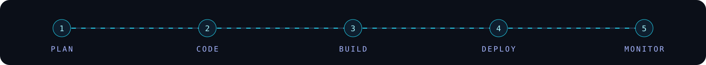

<table align="center" width="96%"><tr><td valign="top">

<h2>Building for the web &amp; the cloud</h2>

I'm <strong>Kavindu Oshadha Perera</strong>, a cloud computing undergraduate based in <strong>Sri Lanka</strong>, with an interest in DevOps, networking and web development.

I enjoy turning ideas into practical projects and learning how to build, deploy and maintain reliable systems.

<table>
<tr>
<td><strong>Web Development</strong> Next.js · React · TypeScript · Node.js</td>
<td><strong>Cloud &amp; Infrastructure</strong> AWS · DigitalOcean · Linux · VPS</td>
</tr>
<tr>
<td><strong>DevOps &amp; Tools</strong> Docker · Git · GitHub · Bash</td>
<td><strong>Current Focus</strong> Cloud Computing · Networking · Automation</td>
</tr>
</table>

<strong>SLTC Research University</strong> 
Explore my work at <a href="https://oshadha.live">oshadha.live</a> 
<em>Learning, building and improving — one project at a time.</em>

</td></tr></table>

<h2 align="center">Technology Stack</h2>

<h2 align="center">Featured Work</h2>

<table align="center" width="96%">
<tr>
<td width="50%" valign="top"><h3>Oska VPN Portal</h3>Next.js · Firebase · VPS
A portal project focused on VPN services and infrastructure.
<a href="https://oskavpn.codes">Visit project →</a></td>
<td width="50%" valign="top"><h3>Dynamic Portfolio</h3>Personal website
My online space for projects, skills and contact details.
<a href="https://oshadha.live">Visit portfolio →</a> · <a href="https://github.com/cit-24-01-0476-maker/dynamic-portfolio">Source</a></td>
</tr>
<tr>
<td width="50%" valign="top"><h3>Leo Treasury Report Maker</h3>TypeScript
A project for creating treasury reports.
<a href="https://github.com/cit-24-01-0476-maker/Leo-Tresuare-Report-Maker">Explore repository →</a></td>
<td width="50%" valign="top"><h3>SPM Web Project</h3>Web development
A web project in my development portfolio.
<a href="https://github.com/cit-24-01-0476-maker/SPM-WEB-INTRO-FINAL">Explore repository →</a></td>
</tr>
</table>

<a href="https://github.com/cit-24-01-0476-maker?tab=repositories"><b>Explore all repositories →</b></a>

<h2 align="center">Activity</h2>

<h2 align="center">Let's build something useful</h2>

Cloud computing · DevOps · Networking · Web development

<a href="https://oshadha.live">Portfolio</a> · <a href="https://www.linkedin.com/in/kavindu-oshadha-perera/">LinkedIn</a>

Layout and hero adapted from <a href="https://github.com/Sandeepa-git/Sandeepa-git">Sandeepa Wimalasiri's profile</a>, personalized with a cyan and indigo palette.
